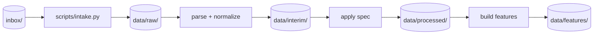
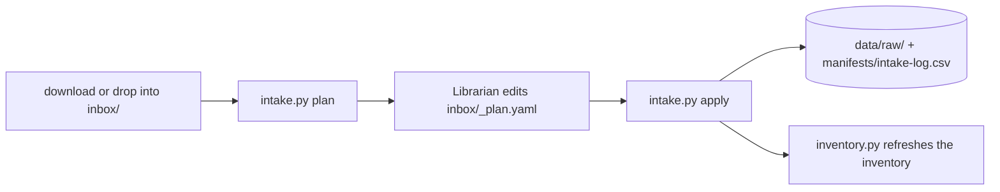

# Data standard

How data moves from original files to model inputs. Names, units and time:
[naming-units-time.md](naming-units-time.md). Card format: [writing.md](writing.md#data-card).
Map: `data/INDEX.md` (derived stages), `knowledge/data/INDEX.md` (raw and prior, via data cards).
Where the folders live and how the drives are linked: [Storage](#storage).

## Stages



| Stage | Folder | Contains | Rules |
|---|---|---|---|
| raw | `data/raw/` | Files exactly as delivered, original names | Immutable. Written only by `scripts/intake.py`. Junction to E:. |
| interim | `data/interim/` | Parsed tables, canonical names and units, UTC | Normalization only: no methodology choices. One table set per source. |
| processed | `data/processed/` | Output of a spec'd step (QC, gap rules, aggregation, target series) | Each table names the spec section that produced it. |
| features | `data/features/` | Model-ready tables and grids | Built from processed by a spec'd feature step. |

- **Methodology starts at processed.** Interim is lossless apart from renaming, unit and
  time conversion. A dropped or filled value is a methodology choice, so it belongs later.
- Layout: `data/<stage>/<dataset-slug>/<table>.parquet`. `<dataset-slug>` matches the
  data card name.
- Every stage folder is gitignored. Any stage is rebuildable from raw + `config/` + code.
- Never edit a derived file by hand. Rerun the step.

## Formats

| Data | Format | Notes |
|---|---|---|
| Tables | Parquet (pyarrow) | Typed columns; `time_utc` as tz-aware UTC. |
| Gridded fields | Zarr | Named dims, e.g. `time_utc`, `lat_deg`, `lon_deg`. |
| NetCDF / GRIB | Only to read what a source delivers, or where a tool needs it | Convert to Zarr at interim. |
| CSV | Raw only (as delivered) | Never write CSV into a derived stage. |

## Raw immutability and intake

- Never write, move or delete in `data/raw/`, `data/prior/`, `archive/` or the legacy folders.
  Hooks block it, including paths given through the link target (`E:\CLEAR 2.0\RAW Data\...`).
- New files enter through `inbox/` only:



- `apply` refuses to overwrite. Across drives (C: to E: through the `data/raw` junction) it
  copies, hashes the copy, compares with the source hash, and only then deletes the source;
  on a mismatch it deletes the bad copy and keeps the source.
- `apply` refuses a plan whose destination area is offline (drive unplugged), that has `..`
  segments in a path, or that lists the same `src` twice.
- Run as `uv run python scripts/intake.py plan` then `... apply inbox/_plan.yaml`.
- `/ingest` downloads into `inbox/`, then uses intake. Every download gets a
  `data/sources.yaml` entry.

## Inventory

- `manifests/inventory.csv`: one row per original file (~175k rows). Local only: gitignored,
  whitelisted in `.ignore` so Grep can search it.
- `manifests/inventory-summary.csv`: committed. One row per dataset folder (area folder +
  one level, e.g. `data/raw/NOAA`). Columns: `folder,area,files,bytes,mapped,unmapped,stale,superseded,junk`.
- Read the summary first, then Grep `inventory.csv` for specific files. Never sweep the folders.

## data/sources.yaml: provenance entry

One entry per raw dataset. Committed. Values below are placeholders.

| Field | Meaning |
|---|---|
| `id` | Dataset slug; matches the data card name |
| `provider` | Organisation that publishes the data |
| `url` / `api` | Landing page, or API endpoint |
| `query` | Exact request parameters (stations, variables, bounding box, dates) |
| `downloaded_utc` | When fetched, ISO 8601 UTC |
| `license` | Licence or terms of use, quoted or linked |
| `redistribution_allowed` | `yes` / `no` / `unknown`. `unknown` blocks making the repo public. |
| `sha256` | List of hashes, one per raw file |
| `notes` | Anything a later reader needs: version, product level, caveats |

```yaml
- id: <dataset-slug>
  provider: <organisation>
  url: <https://...>
  api: null
  query: {<param>: <value>}
  downloaded_utc: 2026-10-21T00:00:00Z
  license: <verify>
  redistribution_allowed: unknown
  sha256: [<hash>, <hash>]
  notes: <product version, caveats>
```

- Files that arrived without a known origin get `provider: unknown` and `license: unknown`.
  Fill them in later; do not guess.

## Schemas at every stage boundary

- Each boundary (raw→interim, interim→processed, processed→features) has a pandera schema
  in `src/clear/schemas/`, built from the helpers in `common.py`.
- Validate on **write** (producer) and on **read** (consumer). Use `lazy=True` so one run
  reports every failure.
- Baseline checks for every table: `time_utc` tz-aware UTC; unique key (e.g.
  `station_id` + `time_utc`); concentrations ≥ 0; canonical column names; expected dtypes.
- A schema change is a code change: it needs a contract test and passes review.
  Examples: [code.md](code.md#contract-pandera).

## Validation reports

Specs define what "valid" means, so validation (Phase 3) follows specs. `/validate-data`
checks a dataset against its spec and writes the result.

- Report: `knowledge/data/<dataset-slug>.validation.md`. Contents: spec section checked,
  one row per check (expected, observed, pass/fail), coverage gaps, issues, verdict.
- The data card links it in `validation_report`, and sets `validation`:

| `validation` | Meaning |
|---|---|
| `unvalidated` | No report yet. |
| `partial` | Report exists; some checks, variables or years not covered or failing. The report lists the gaps. |
| `validated` | Every check the spec requires passes for the coverage the card declares. |

- The Data Steward signs off. Ryan is not a gate here. A check that exposes a methodology
  conflict becomes an ADR (`proposed`).
- An experiment README states the `validation` status of every dataset it uses.

## Storage

| Drive | Role |
|---|---|
| C: internal NVMe | The repo. `data/interim`, `data/processed`, `data/features` live here (local, fast). |
| E: internal 1 TB NVMe | Raw working copy: `E:\CLEAR 2.0\RAW Data` (886.5 GB, ~155k files). |
| D: Seagate Expansion 4 TB (USB, exFAT, label `RyanCLEAR`) | Backup of raw (`D:\CLEAR 2.0\RAW Data`) and of `archive/` (`D:\CLEAR 2.0\archive`). Only home of prior outputs (`D:\CLEAR 2.0\Cleaned Data`, 130 GB, ~18k files). |

- The Seagate is also used on a Mac. macOS writes `._*` junk there; it is never copied.
- `data/raw` is a Windows junction to `CLEAR_RAW_DIR`; `data/prior` is a junction to
  `CLEAR_PRIOR_DIR`. Tools, data cards and hooks keep using the repo paths.
- Paths live in `.env` (gitignored: one machine's paths; template `.env.example`):

| Key | Holds |
|---|---|
| `CLEAR_RAW_DIR` | Target of `data/raw` |
| `CLEAR_PRIOR_DIR` | Target of `data/prior` |
| `CLEAR_BACKUP_RAW_DIR` | Backup of raw: `data/raw/<x>` ↔ `<backup>/<x>` |
| `CLEAR_BACKUP_ARCHIVE_DIR` | Backup of `archive/`: `archive/<x>` ↔ `<backup>/<x>` |

| Command | Does |
|---|---|
| `uv run python scripts/storage.py` | Status: each link, its target, online/OFFLINE, free GB; each backup folder online/offline. Exit 1 if a configured store is offline or not linked. |
| `uv run python scripts/storage.py link` | Creates missing links from `.env`. |
| `uv run python scripts/storage.py link --relink` | Re-points a link whose target changed (e.g. new drive letter). |
| `uv run python scripts/storage.py verify` | Hashes each backup copy of every inventory row against `inventory.csv`; one line per dataset folder. `--folder` limits it. Backup files that are not in the inventory are not checked. |

- `link` never moves or deletes data. It refuses if `data/raw` is a real folder with files.
- Run `storage.py` first in any session that reads raw or prior files.

### Offline drive

- Link target missing (Seagate unplugged → `data/prior` OFFLINE): `scripts/inventory.py`
  keeps that area's rows from the last inventory and warns. It does not drop them.
- Only work that reads raw or prior files needs the drive. Maps, specs and `knowledge/`
  always work.

### Backup

- Originals are irreplaceable; derived stages are not. The Seagate backs up `data/raw/` and
  `archive/`, with the same layout below each backup folder.
- `/backup-check` compares each area with `manifests/inventory.csv` by path and sha256 and
  lists missing and mismatched files. Extras (backup files not in the inventory) are not
  checked. Run it after every intake and before any large reorganisation.
- The copy step only adds missing files and never overwrites or deletes on the backup
  (`robocopy` with `/XC /XN /XO`; never `/MIR` or `/PURGE`). Details: `/backup-check`.
- `data/prior` exists only on the Seagate: a known single-copy risk.

### Prior outputs (`data/prior/`)

- Old pipeline outputs from earlier CLEAR work: ERA5/BlueSky/HRRR per-cell extracts,
  features, training sets, models.
- Reference and golden numbers only. Not a pipeline input until Phase 3 validates it against
  raw and an ADR approves reuse per dataset.
- One folder data card per prior dataset: `source: data/prior/<folder>`,
  `validation: unvalidated`. Format: [writing.md](writing.md#data-card).
