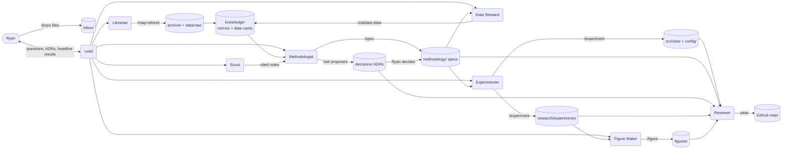

# 00 — System overview

How CLEAR 2.0 gets researched and built with agents. Read this first, then only the
section you need.

| Doc | Covers |
|---|---|
| [01-context-layer.md](01-context-layer.md) | inbox → archive/raw → mirrors, data cards, INDEX maps, hooks |
| [02-agents.md](02-agents.md) | The roster, model split, who owns which skill, delegation |
| [03-workflow.md](03-workflow.md) | Phases (one per system stage), the stage loop, Ryan's gates |
| [04-review-and-commit.md](04-review-and-commit.md) | Review gate, pre-commit, commit/push, CI |
| [05-tooling.md](05-tooling.md) | uv, ruff, pyright, pytest, pre-commit, GitHub Actions |

## The whole system on one page

## Node shapes (used in every diagram in this repo)

| Shape | Mermaid | Meaning |
|---|---|---|
| Cylinder | `[(...)]` | Data or a folder of artifacts |
| Box | `[...]` | Process or script |
| Diamond | `{...}` | Decision |
| Hexagon | `{{...}}` | Human gate (Ryan) |
| Rounded | `(...)` | Agent |

## Design principles

1. **Maps before search.** An agent should reach any fact in ≤ 3 small reads:
   AGENTS.md → INDEX.md → file. Searching the archive is blocked by hooks.
2. **Text over binaries.** Originals are kept untouched; agents read their mirrors.
3. **One source of truth per kind of fact.** Methodology → specs. Decisions → ADRs.
   Constants → `config/`. Names → `GLOSSARY.md`. State → `STATUS.md`.
4. **Ryan decides methodology; agents do everything else.** Two gates only:
   ADRs and headline results.
5. **Every commit is reviewed or mechanical.** Gated paths need a passing independent
   review (Opus 5.5, fresh context). Maps and mirrors are mechanical and skip review.
6. **Reproducible by construction.** Raw data is immutable with provenance; every
   number comes from code + config; every figure from a script; old analyses become
   golden tests.
