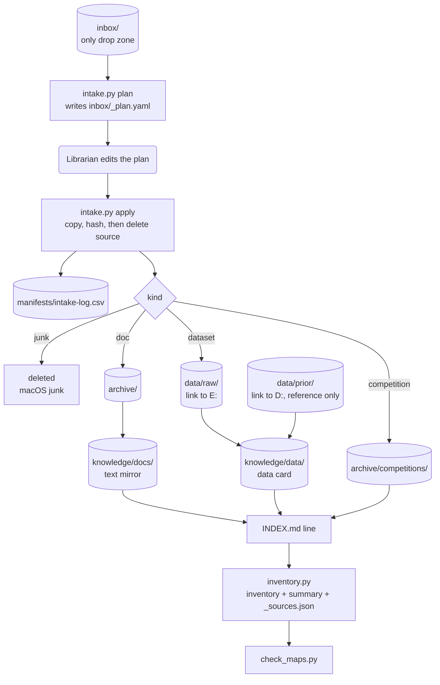

# 01 — Context layer

How a file gets from Ryan's hands to something an agent can find in three reads.
Rules live in [AGENTS.md](../../AGENTS.md); formats live in [writing.md](../standards/writing.md)
and [data.md](../standards/data.md). This page shows the flow.

## File lifecycle



| # | Step | Who | Command / output |
|---|---|---|---|
| 1 | Drop | Ryan | Files into `inbox/`. `/ingest` also downloads here first. |
| 2 | Plan | Librarian | `uv run python scripts/intake.py plan` (`--legacy` adds the legacy folders) → `inbox/_plan.yaml`: `{src, action: move\|delete\|skip, dest, kind, reason}` |
| 3 | Edit plan | Librarian | Fix `dest`, mark copies, route competition material |
| 4 | Apply | Librarian | `uv run python scripts/intake.py apply inbox/_plan.yaml` — verified move (below), refuses to overwrite, deletes junk, logs to `manifests/intake-log.csv`, re-runs inventory |
| 5 | Convert | Librarian | `markitdown` (pandoc fallback) → mirror or data card in `knowledge/` |
| 6 | Index | Librarian | One line per file: `- [name](path) — what it is · status · key fact` |
| 7 | Inventory | Librarian | `uv run python scripts/inventory.py` → `manifests/inventory.csv` (local), `manifests/inventory-summary.csv` (committed), `knowledge/_sources.json` |
| 8 | Check | Librarian | `uv run python scripts/check_maps.py` (full run, data drives online) |

Steps 2–8 are one skill: `/map-refresh`. `intake.py` is the only writer into protected paths
(`archive/`, `data/raw/`, `data/prior/`, the two legacy folders). Never move files by hand.

**Verified move.** Across drives (C: to E: through the `data/raw` junction) `apply` copies,
hashes the copy, compares it with the source hash, and only then deletes the source. On a
mismatch it deletes the bad copy and keeps the source. `apply` refuses a plan whose destination
area is offline (drive unplugged), that has `..` segments in a path, or that lists a `src` twice.

**Map check.** The full `check_maps.py` (run by `/map-refresh`; walks every original, so
`data/raw` and `data/prior` must be online) fails on: an unmapped, stale or junk original
(`data/prior` included), a mirror whose `sha256` differs from its source, plus everything `--ci`
checks. It prints one line per (status, dataset folder), e.g. `unmapped original:
data/raw/NOAA/x.grib2 (+143008 more in data/raw/NOAA) — run /map-refresh`.
`check_maps.py --ci` (pre-commit and CI) checks only size budgets, dead `decisions/NNNN-*.md`
links, repo-map folders without an `INDEX.md`, and mirror frontmatter.

## Where folders live

| Repo path | Physically | Backup |
|---|---|---|
| `archive/` | C: (the repo) | `D:\CLEAR 2.0\archive` |
| `data/raw/` | Junction → `CLEAR_RAW_DIR` (`E:\CLEAR 2.0\RAW Data`) | `D:\CLEAR 2.0\RAW Data` |
| `data/prior/` | Junction → `CLEAR_PRIOR_DIR` (`D:\CLEAR 2.0\Cleaned Data`) | None (single copy) |
| `data/{interim,processed,features}/` | C: (local, fast) | None (rebuildable) |
| Everything else | C: (the repo, in git) | GitHub |

`uv run python scripts/storage.py` shows each link and whether its drive is online. A link whose
drive is unplugged leaves its inventory rows in place (warning, no loss). Details:
[data.md](../standards/data.md#storage).

## knowledge/ layout

```text
knowledge/
├── INDEX.md          map of archive/: one line per doc, one per competition folder
├── _sources.json     { "<source path>": {"mirror": "...", "sha256": "..."} }  (generated)
├── docs/             one .md mirror per logical doc, slugified path
└── data/
    ├── INDEX.md      map of data/raw/ and data/prior/: one line per dataset
    ├── <dataset-slug>.md              data card
    └── <dataset-slug>.validation.md   written by /validate-data
```

- **Slug:** lowercase, spaces and punctuation → `-`. Illustrative:
  `archive/Some Folder/My Doc (v2).docx` → `knowledge/docs/some-folder/my-doc-v2.md`.
- **Mirror frontmatter** (data cards add fields — see [writing.md](../standards/writing.md)):

```yaml
---
source: archive/<original path>        # exact original path
aliases: [archive/<same doc>.pdf]      # other formats or copies of the same doc
sha256: <hash of source at conversion>
converted: 2026-10-21
converter: markitdown                  # markitdown | pandoc | manual
status: current                        # current | superseded
kind: mirror                           # mirror | data-card
---
```

- **Data card extras:** `dataset`, `provider`, `variables`, `units`, `time_coverage`,
  `time_convention`, `spatial_coverage`, `rows`, `validation`
  (`unvalidated|partial|validated`), `validation_report`.
- **Inventory columns** (`manifests/inventory.csv`, local only, Grep-able; one row per original,
  ~175k rows): `path,area,bytes,sha256,modified_utc,kind,mirror,status`.
  `status` is `mapped|unmapped|stale|superseded|junk`.
- **Inventory summary** (`manifests/inventory-summary.csv`, committed; one row per dataset
  folder, e.g. `data/raw/NOAA`): `folder,area,files,bytes,mapped,unmapped,stale,superseded,junk`.
  Agents read it first, then Grep `inventory.csv` for specific files.
- **Prior-output cards:** a folder card per `data/prior/` dataset: `source: data/prior/<folder>`,
  `validation: unvalidated`.
- Mirrors are evidence. The canonical rule for any method is the spec in `methodology/`.

## Duplicate and version rules

| Case | Rule |
|---|---|
| Same doc in several formats | One mirror, from the docx if there is one. Other formats go in `aliases`. |
| Identical copy (same sha256) | Listed in `aliases` of the same mirror. |
| Older version of a doc | `status: superseded`. No mirror unless it holds unique content. INDEX line says superseded. |
| xlsx / csv / any dataset | Data card in `knowledge/data/`. No full-text mirror. |
| PNG | One-line description in INDEX.md. Embedded doc images are extracted only when a spec cites them. |
| macOS junk (`._*`, `.DS_Store`) | Deleted at intake. |
| Name already exists at `dest` | `apply` refuses. Librarian changes `dest` in the plan. |

## Competition fencing

- Competition, pitch and video material goes to `archive/competitions/...`.
- One INDEX line per folder, not per file.
- Agents open it only when Ryan asks. This project is research-only.

## How an agent navigates

Three reads: **AGENTS.md → folder `INDEX.md` → the file.** Or run `/where <question>`.

| Looking for | Read 2 (INDEX) | Read 3 |
|---|---|---|
| A method rule | `methodology/INDEX.md` | the spec |
| What an original doc says | `knowledge/INDEX.md` | the mirror |
| A dataset's units, time convention, coverage | `knowledge/data/INDEX.md` | the data card |
| Why something was chosen | `decisions/INDEX.md` | the ADR |
| A constant | `config/INDEX.md` | the YAML |
| A term or code name | — | `GLOSSARY.md` |
| Does file X exist, where is its mirror | `manifests/inventory-summary.csv` (per folder) | Grep `manifests/inventory.csv` |

Never Glob/Grep the protected folders. Never open an original that has a mirror.

## Claude Code hooks

Config in `.claude/settings.json`; scripts in `.claude/hooks/` (stdlib Python). A block is
exit code 2 plus a message on stderr. Follow the message; never work around it.

| Hook | Trigger | Blocks | Why |
|---|---|---|---|
| `guard.py` | PreToolUse: Read, Write, Edit, MultiEdit, NotebookEdit, Glob, Grep, Bash, PowerShell | Write/Edit into a protected path | Originals are immutable |
| | | `inbox/`: agents may add new files and edit `inbox/_plan.yaml`; no Glob/Grep sweeps, deletes or overwrites inside it | `intake.py` does the moving |
| | | Glob/Grep with a path or pattern inside a protected path → "use knowledge/, INDEX.md or manifests/inventory.csv" | Sweeps flood context; the maps answer faster |
| | | Any recursive Glob whose base folder (the `path` plus the pattern's literal leading folders, e.g. `data/**/*.csv` → `data`) is above or inside a protected folder → scope it (`src/**/*.py`, `data/processed/**/*.parquet`). Also a recursive Glob from outside the repo above a link target (`E:/`) | Claude Code's Glob ignores `.gitignore`, so recursion from above walks the originals |
| | | A path given through the link target (`E:\CLEAR 2.0\RAW Data\...`, `D:\CLEAR 2.0\Cleaned Data\...`) is mapped back to `data/raw/` or `data/prior/` and gets the same protection | Junctions must not bypass the guard |
| | | Read of a file listed in `knowledge/_sources.json` (source or alias) → replies with the mirror path | Text over binaries |
| | | Bash/PowerShell that writes protected paths: `rm`, `mv`, `cp`/`robocopy` into, `>` (quoted or `RAW\ Data` escaped), `sed -i`/`perl -pi`, `tar -C`, `gunzip`, `curl -o`, `Invoke-WebRequest -OutFile`, `ruff --fix`, `Remove-Item`, `Move-Item`, `del` | Same as Write/Edit |
| | | Delete or move of a folder that holds a protected one (`rm -rf data`, `data/*/*`, `Remove-Item -Recurse data`, `cmd /c rmdir /s data`), of anything above the repo or a data drive, or of a Seagate backup folder (from `.env`); `robocopy /MIR /PURGE /MOV` near either | It would take the originals with it |
| | | `git clean -x/-X` and `git stash --all`, also with global options (`git -C . clean -fdx`) | They remove gitignored files, i.e. the originals |
| | | `cd`, `pushd`, `Set-Location` into a protected folder; a `cd` carries over to later commands in the same call | Relative commands would then run inside it |
| | | `find`, `ls -R`, `tree`, `grep -r`, `Get-ChildItem -Recurse`, `dir /s`, `rg -uu` from a folder that holds originals (`.`, `data`); plain `rg`/`fd` only when naming one (they honour `.ignore`) | Same as Glob/Grep |
| | | `git commit --no-verify`/`-n`, setting `CLEAR_SKIP_REVIEW` or pre-commit's `SKIP=`, `core.hooksPath`, `pre-commit uninstall`, writes into `.git/hooks` or `.git/config` | Switching the commit guards off is Ryan only |
| `post_edit.py` | PostToolUse: Write, Edit, MultiEdit | Nothing. Runs `ruff format` + `ruff check --fix` on `.py`; leftover lint errors exit 2 with the errors | Code is formatted before review |

Commands are checked one by one (split on `;`, `&&`, `||`, `|`, `&` outside quotes), including
inside `cmd /c`, `powershell -c`, `bash -c` and `$(...)`; `/e/...` Git Bash drive paths count. A
command is exempt only when it actually runs `python scripts/intake.py` or `scripts/inventory.py`.

**Guard limits.** It prevents accidents, not deliberate evasion. Not caught: paths fed through
`xargs` or stdin, deletes inside `python -c`/scripts, tools not listed above, `cp -t DIR`, Git
Bash `//MIR`-style switches, `findstr /s`, a redirect outside `cmd /c "..."`, non-recursive
wildcard listings (`data/r*/*`). Backups are the real safety net; `data/prior` has none yet.

Backstop outside Claude Code: the `guard_commit.py` pre-commit hook rejects staged protected
paths, `inbox/` files (except README), `data/` (except `sources.yaml`, `INDEX.md`), `*.ipynb`,
files over 1 MB and secret-looking strings. See [04-review-and-commit.md](04-review-and-commit.md).

## Add a file tomorrow

1. **Drop it in `inbox/`.** Nowhere else. Leave legacy folders alone.
2. **Run `/map-refresh`.** Plan, apply, mirror or card, INDEX line, inventory, map check.
3. **Commit and push** the new `knowledge/`, INDEX and `manifests/` changes. They skip review.

A dataset to download instead: run `/ingest` — it fetches into `inbox/`, records provenance in
`data/sources.yaml`, then hands off to intake.
