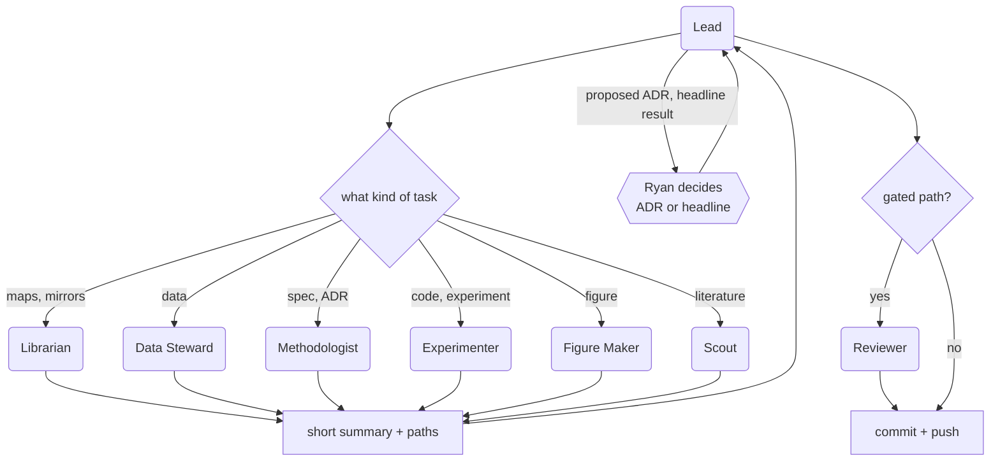
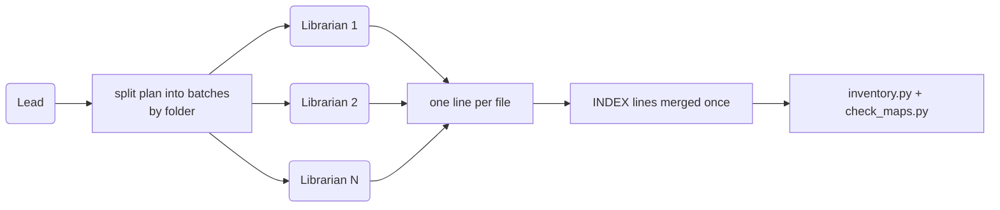

# 02 — Agents

Who does what, which model runs it, and how work flows between them. Role summary lives in
[AGENTS.md](../../AGENTS.md); agent files live in `.claude/agents/<name>.md` (each pins its
`model:`). The Lead is the main session and has no file.

## Roster

| Role | Model | Owns | May write | Must not |
|---|---|---|---|---|
| **Lead** | Opus | Plan, delegation, `STATUS.md`, asking Ryan | `STATUS.md`, `research/log/` | Resolve a methodology conflict silently; skip a specialist's gate |
| **Librarian** | Sonnet | `/where`, `/map-refresh` | `knowledge/`, `INDEX.md` files, `inbox/_plan.yaml`; protected paths only through `intake.py` | Edit specs or code; decide methodology |
| **Data Steward** | Opus | `/ingest`, `/validate-data`, `/backup-check` | `data/sources.yaml`, `knowledge/data/*.validation.md`, card `validation` fields, downloads into `inbox/` | Write `data/raw/` or `data/prior/` directly; change a spec to make data pass |
| **Methodologist** | Opus | `/spec`, `/adr`, `/method-check` | `methodology/`, `decisions/` (ADRs as `status: proposed`) | Mark an ADR accepted; pick a side in a source conflict |
| **Experimenter** | Opus | `/experiment`, pipeline code in `src/clear/` | `src/clear/`, `config/`, `tests/`, `research/experiments/`, `notebooks/` | Hardcode constants; change targets, thresholds, splits or metrics without an ADR |
| **Figure Maker** | Sonnet | `/figure` | `figures/src/`, `figures/out/` | Use a color outside `tokens.yaml`; set `headline: true` |
| **Scout** | Sonnet | External literature → `research/literature/` | `research/literature/` | Write an uncited claim |
| **Reviewer** | Opus 5.5 | `/review` | `.review/last.json` via `check_review.py record`; optional `research/reviews/` notes | Edit the diff it is reviewing |

All roles obey the hard rules in [AGENTS.md](../../AGENTS.md): originals immutable, no sweeps,
no binaries when a mirror exists, no magic numbers, no AI attribution in commits.
Only the Lead talks to Ryan.

## Why the model split

| Choice | Reason |
|---|---|
| Opus for Lead, Data Steward, Methodologist, Experimenter | Judgment-heavy: planning, reading conflicting sources, deciding what "valid" means, writing pipeline code under strict typing |
| Sonnet for Librarian, Figure Maker, Scout | Structured, high-volume, rule-bound: mirrors, INDEX lines, figures from a standard, literature notes with citations |
| Opus 5.5 for the Reviewer | Strongest judgment on the gate. Independence comes from a fresh context: it sees only the diff, specs and checklist, never the author's reasoning |

## Delegation



- Independent tasks go out in one message, in parallel. Dependent ones go one at a time.
- Each delegation names: the goal, the files to read (INDEX, spec, mirror), what is ruled out,
  and the return format.
- Gated paths and the review loop: [04-review-and-commit.md](04-review-and-commit.md).

## Return contract

A specialist returns a **short summary with paths. Never file contents.**

```text
Done:  <one line>
Files: <path> — <what changed>        (one line per file)
Open:  <question for Ryan, or "none">
Next:  <suggested next step, or "none">
```

- Questions for Ryan go in `Open:`. Specialists never ask Ryan directly.
- Proposed ADRs and candidate headline results are reported, never self-approved.
- If blocked by a hook, report the hook message; do not work around it.
- The Lead reads the files it needs from the paths, not from the summary.

## Reviewer

`/review` delegates to the `reviewer` subagent (`.claude/agents/reviewer.md`, `model: opus`
= Opus 5.5) through the Agent tool. Same path inside T3 Code and in the plain CLI.

- Input: the staged diff, the spec and ADR links it cites, and the checklist in
  [04-review-and-commit.md](04-review-and-commit.md). Not the author's reasoning or verdict.
- Output: `pass` or `fail`, plus numbered findings (`path:line`, rule broken, suggested fix).
- Read-only tools (`Read, Grep, Glob, Bash`); it never edits or stages.
- Max 2 fix rounds, then the Lead escalates to Ryan.
- Record the verdict as `--reviewer "claude/opus-5.5"`.

## Bulk fan-out

For dozens of files (for example, mirroring a folder of docs) the Lead splits the work into
batches and runs Librarians in parallel.



- Each batch owns different mirror files, so batches never edit the same file.
- Each Librarian returns one line per file: `path — status`. Never the converted text.
- One agent merges INDEX lines after the fan-out, then runs the inventory and map check.
- The same pattern applies to other bulk work: one specialist type, parallel batches,
  one-line summaries.
