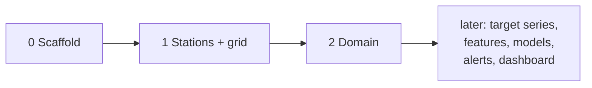
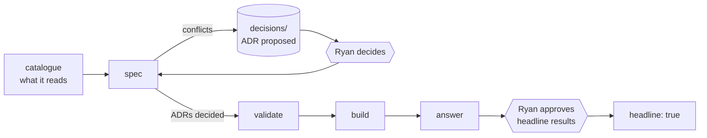
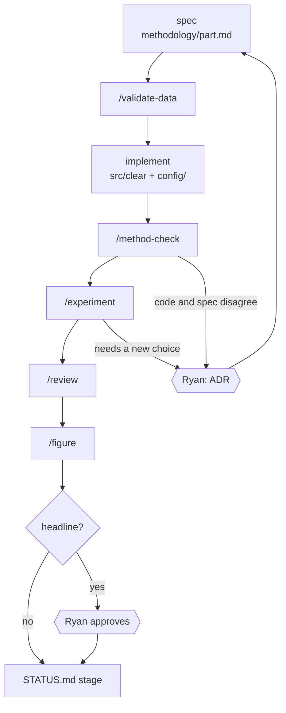
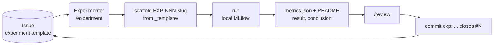

# 03 — Workflow

Phases, the stage loop inside each phase, issues, and the start and end of every session.
Ryan has two gates: **ADRs / methodology decisions** and **headline results / figures**.
Everything else (including data-validation sign-off) agents decide.

## Phases

Each phase builds one stage of the forecasting system. It opens with questions (GitHub
Issues) and closes when their answers are built, checked and posted on the Issues.

| Phase | Stage | Opened by | Parts |
|---|---|---|---|
| 0 | Scaffold — this R&D system | — | — |
| 1 | Stations + grid — Toronto government monitors, 0.1° grid | prompts 1–2 | `stations`, `grid` |
| 2 | Domain — smoke directions, warning radius, cell size | prompts 3–5 | `grid` (domain), `lag-plume`, `era5-wind` |
| later | target series → features → models → alerts → dashboard | — | the rest |

## The stage loop

Every phase runs the same five steps, and only for what its stage reads and builds.
An ADR can arise at any step (a golden-test mismatch, a new choice mid-build). It always
goes through the same hexagon.

### Phase 0 — Scaffold (done)

`AGENTS.md`, `docs/`, `.claude/` agents, skills and hooks, `scripts/`, the `src/clear/`
skeleton, `config/`, `tests/`, `figures/`, pre-commit, CI, private repo `clear2.0`.
**Exit:** `uv run pre-commit run --all-files` passes; the first push to `main` is green.

### 1. Catalogue

- [ ] Scoped intake: `intake.py plan --legacy`, plan edited to file only the doc folders
      this stage reads; the rest waits for its phase
- [ ] Mirrors of those docs; a data card (`unvalidated`) per dataset the stage reads,
      `data/prior` reference cards included
- [ ] Each card states time convention, missing-value codes and units; unclear = `unknown`
- [ ] `/ingest` new raw datasets; a `sources.yaml` entry per dataset read
- [ ] `uv run python scripts/storage.py` exits 0 (`data/raw`, `data/prior` online)

**Exit:** every input has a card and a `sources.yaml` entry; `check_maps.py` passes.

### 2. Spec

- [ ] `/spec` per part the stage builds, from `methodology/_template.md`; Scout fills gaps
- [ ] Every source conflict or new choice is an ADR (`status: proposed`) and an open
      question in the spec
- [ ] Constants in `config/*.yaml`, each linked to its spec section or ADR
- [ ] `GLOSSARY.md` covers every term the specs use

**Exit:** each part has a spec; every ADR the build depends on is decided by Ryan.

### 3. Validate

- [ ] `/validate-data` per dataset the stage reads, against what its spec requires
- [ ] Report in `knowledge/data/<slug>.validation.md`; card `validation:` updated
- [ ] Time conventions normalized and documented in each card
- [ ] Golden-test targets listed: numbers old docs reported and the code must reproduce

**Exit:** every dataset is `validated`, or `partial` with the gap stated in its report.
The Data Steward signs off; Ryan is not a gate here.

### 4. Build

Each part runs the per-part loop below. The `ml` dependency group arrives with the models
phase.

**Exit per part:** tests (unit, contract, golden) pass; outputs pass their pandera schemas;
`/method-check` clean; `/review` pass; STATUS stage set to `built`.

### 5. Answer

- [ ] `/experiment` per opening question: `EXP-NNN-slug/` with README + `metrics.json`
- [ ] `/figure` for each figure the answer needs
- [ ] The Lead comments the result on each opening Issue; nothing is `headline: true`
      without Ryan

**Exit for the phase:** every opening Issue has a result comment; STATUS stages are
`answered`; STATUS moves to the next phase.

## Per-part R&D loop

Inside a phase, each part runs this loop from its spec to its STATUS stage.

| Step | Agent | Output |
|---|---|---|
| Spec | Methodologist | `methodology/<part>.md`, ADRs |
| Validate | Data Steward | validation report, card status |
| Implement | Experimenter | `src/clear/<part>.py`, `config/*.yaml`, tests incl. golden |
| Method check | Methodologist | code vs spec report |
| Experiment | Experimenter | `research/experiments/EXP-NNN-slug/` |
| Review | Reviewer | pass / fail ([04-review-and-commit.md](04-review-and-commit.md)) |
| Figure | Figure Maker | `figures/src/fig_<slug>.py` + `out/` |
| STATUS | Lead | stage column updated |

Stages in STATUS: catalogued → spec'd → validated → built → answered.

## GitHub Issue → experiment

Issues are the backlog. Templates: `experiment`, `data-validation`, `methodology-question`,
`figure`. There is no Project board (the token lacks the scope).

| Template | Picked up by | Skill |
|---|---|---|
| `experiment` | Experimenter | `/experiment` |
| `data-validation` | Data Steward | `/validate-data` |
| `methodology-question` | Methodologist | `/spec`, `/adr` |
| `figure` | Figure Maker | `/figure` |

- `README.md` fields: hypothesis, issue, spec, config, result, conclusion.
- `metrics.json` holds the headline numbers. Per-run detail stays in `mlruns/` (gitignored).
- Agents read the README and `metrics.json`, never `mlruns/`.
- A result headed for a paper or pitch goes to Ryan before `headline: true`.

## Session start

1. Read `STATUS.md`: phase, per-part stage, blockers, next 3 actions, open questions.
2. Find anything else through the maps: AGENTS.md → INDEX.md → file, or `/where <question>`.
3. Pick work from "Next 3 actions" or an open Issue. Delegate by role
   ([02-agents.md](02-agents.md)).

## Session end

1. Rewrite `STATUS.md` (≤ 60 lines): phase, per-part stage, blockers, next 3 actions,
   open questions for Ryan.
2. Append a few bullets to `research/log/YYYY-MM-DD.md`: decisions, outcomes, what is next.
3. Run `uv run python scripts/check_maps.py --ci` (size budgets, links, INDEX files; the full
   check is for `/map-refresh` and `/ingest`).
4. Commit (`docs:`) and push. STATUS and the log skip review.
