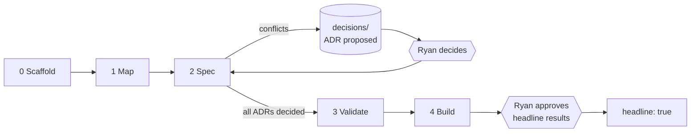
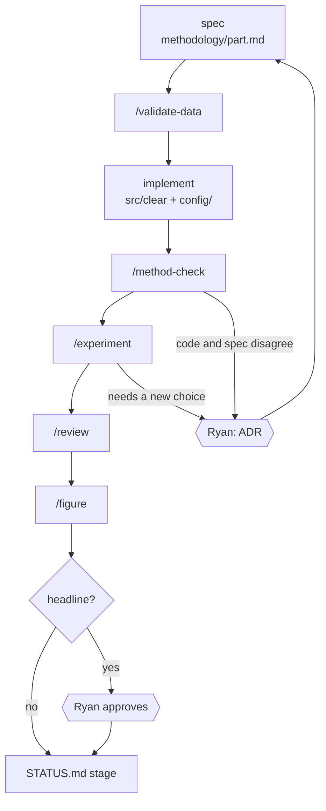
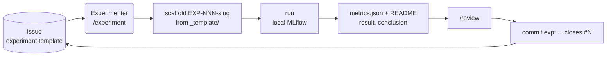

# 03 — Workflow

Phases, the per-part loop, issues, and the start and end of every session.
Ryan has two gates: **ADRs / methodology decisions** and **headline results / figures**.
Everything else (including data-validation sign-off) agents decide.

## Phases

An ADR can arise in any phase (a golden-test mismatch, a new choice mid-build). It always
goes through the same hexagon.

## Checklists and exit criteria

### Phase 0 — Scaffold

- [ ] `AGENTS.md`, `CLAUDE.md`, `STATUS.md`, `GLOSSARY.md`, `docs/`
- [ ] `.claude/` agents, skills, hooks
- [ ] `scripts/` (storage, inventory, intake, check_maps, guard_commit, check_review)
- [ ] `src/clear/` skeleton, `config/`, `tests/`, `figures/`
- [ ] Pre-commit installed, CI workflow, private GitHub repo `clear2.0`

**Exit:** `uv run pre-commit run --all-files` passes, first push to `main` is green in CI.

### Phase 1 — Map

- [ ] Ryan drops all data and docs in `inbox/` (legacy folders count as inbox sources)
- [ ] `/map-refresh`: plan, apply, mirrors, data cards, INDEX files, inventory
- [ ] `uv run python scripts/storage.py` exits 0 (`data/raw`, `data/prior` linked and online)
- [ ] `/backup-check` against the Seagate (needs the four storage keys in `.env`, see [data.md](../standards/data.md#storage))
- [ ] Every `data/prior/` folder has a data card (`unvalidated`)

**Exit:** `inbox/` empty except README; `inventory.py --check` and `check_maps.py` pass;
the `data/raw/` and `archive/` backups match the inventory.

### Phase 2 — Spec

- [ ] Methodologist confirms the final list of parts (STATUS lists them as provisional)
- [ ] `/spec` per part from `methodology/_template.md`; Scout fills literature gaps
- [ ] Every source conflict is an ADR (`status: proposed`) and an open question in the spec
- [ ] `GLOSSARY.md` covers every term the specs use

**Exit:** each part has a spec; every ADR is decided by Ryan; no open question blocks Phase 3.

### Phase 3 — Validate

- [ ] `/validate-data` per dataset the specs need, against what its spec requires
- [ ] Report in `knowledge/data/<slug>.validation.md`; card `validation:` updated
- [ ] Time conventions normalized and documented in each card
- [ ] Golden-test targets listed: numbers old docs reported and the code must reproduce

**Exit:** every needed dataset is `validated`, or `partial` with the gap stated in its report.
The Data Steward signs off; Ryan is not a gate here.

### Phase 4 — Build

Dependency order: target series → features → models → alerts → dashboard.
Each part runs the loop below. The `ml` dependency group arrives here.

**Exit per part:** tests (unit, contract, golden) pass; `/method-check` clean; `/review` pass;
STATUS stage set to `built`. **Exit for the phase:** all parts built.

## Per-part R&D loop

| Step | Agent | Output |
|---|---|---|
| Spec | Methodologist | `methodology/<part>.md`, ADRs |
| Validate | Data Steward | validation report, card status |
| Implement | Experimenter | `src/clear/<part>.py`, `config/*.yaml`, tests incl. golden |
| Method check | Methodologist | code vs spec report |
| Experiment | Experimenter | `research/experiments/EXP-NNN-slug/` |
| Review | Reviewer | pass / fail ([04-review-and-commit.md](04-review-and-commit.md)) |
| Figure | Figure Maker | `figures/src/fig_<slug>.py` + `out/` |
| STATUS | Lead | stage column updated |

Stages in STATUS: mapped → spec'd → validated → built.

## GitHub Issue → experiment

Issues are the backlog. Templates: `experiment`, `data-validation`, `methodology-question`,
`figure`. There is no Project board (the token lacks the scope).

| Template | Picked up by | Skill |
|---|---|---|
| `experiment` | Experimenter | `/experiment` |
| `data-validation` | Data Steward | `/validate-data` |
| `methodology-question` | Methodologist | `/spec`, `/adr` |
| `figure` | Figure Maker | `/figure` |

- `README.md` fields: hypothesis, issue, spec, config, result, conclusion.
- `metrics.json` holds the headline numbers. Per-run detail stays in `mlruns/` (gitignored).
- Agents read the README and `metrics.json`, never `mlruns/`.
- A result headed for a paper or pitch goes to Ryan before `headline: true`.

## Session start

1. Read `STATUS.md`: phase, per-part stage, blockers, next 3 actions, open questions.
2. Find anything else through the maps: AGENTS.md → INDEX.md → file, or `/where <question>`.
3. Pick work from "Next 3 actions" or an open Issue. Delegate by role
   ([02-agents.md](02-agents.md)).

## Session end

1. Rewrite `STATUS.md` (≤ 60 lines): phase, per-part stage, blockers, next 3 actions,
   open questions for Ryan.
2. Append a few bullets to `research/log/YYYY-MM-DD.md`: decisions, outcomes, what is next.
3. Run `uv run python scripts/check_maps.py --ci` (size budgets, links, INDEX files; the full
   check is for `/map-refresh` and `/ingest`).
4. Commit (`docs:`) and push. STATUS and the log skip review.
