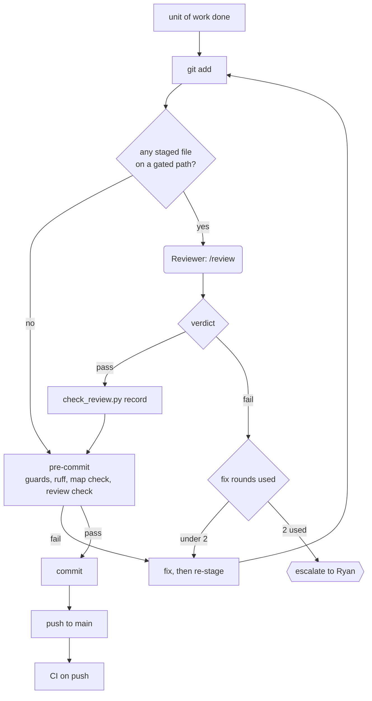

# 04 — Review and commit

Every commit is either reviewed or mechanical. Gated paths need a passing independent review
(Opus 5.5 `reviewer`, fresh context) of the exact staged diff. Git rules: [git.md](../standards/git.md). Reviewer role:
[02-agents.md](02-agents.md).

## Gated and ungated paths

| Gated (review required) | Skip review |
|---|---|
| `src/`, `config/`, `methodology/`, `decisions/`, `research/experiments/`, `figures/src/`, `scripts/`, `tests/`, `.claude/hooks/`, `.claude/skills/review/`, `.claude/agents/reviewer.md`, `.claude/settings.json`, `.github/workflows/`, `.pre-commit-config.yaml`, `.gitignore`, `.ignore`, `pyproject.toml`, `uv.lock` (source of truth: `GATED` in `scripts/check_review.py`) | Maps, mirrors, any file named `INDEX.md` (even inside a gated folder), `STATUS.md`, `research/log/`, `docs/` |

- A commit that stages any gated file needs a passing review. Mixed commits count as gated.
- `check_review.py` sees renames as delete + add, so moving gated code out of a gated folder
  still needs review.

## Flow



1. **Stage** the unit of work. One logical unit per commit. Then run `uv run pre-commit run`
   and re-stage until the fixers (ruff format, end-of-file) change nothing — otherwise they
   rewrite files at commit time and the reviewed diff hash no longer matches.
2. **`/review`** sends the staged diff to the `reviewer` subagent (Opus 5.5).
3. **Fix rounds.** Review round 1 fails → fix round 1 → review round 2 fails → fix round 2 →
   review round 3 fails → escalate. After two fix rounds, the Lead stops and asks Ryan.
4. **Record** the verdict (the `/review` skill does this after each round):

```bash
uv run python scripts/check_review.py record --verdict pass \
    --reviewer "claude/opus-5.5" --round 1 --notes "short note"
```

   Writes `.review/last.json` (gitignored):
   `{diff_sha256, verdict, reviewer, round, notes, time_utc, files}`.
5. **Commit.** Pre-commit runs the checks below. Message: `feat|fix|docs|data|exp|fig|chore: ...`.
   No AI attribution, ever.
6. **Push to `main` right away.** No PRs, no branches.

## Re-staging changes the hash

`diff_sha256` is the sha256 of `git diff --cached --binary`. Any change to what is staged
(a fix, an extra file, a formatter rewrite) changes it. The old record then no longer matches,
`check_review.py check` fails, and the diff needs a new `/review`.

- Fix, re-stage, run `/review`, record, commit. Do not edit between record and commit.
- The `post_edit.py` hook formats `.py` files after each edit, so pre-commit's ruff rarely
  rewrites anything. If it does, re-stage and re-review.

## Pre-commit checks

| Check | Script / tool | Fails when |
|---|---|---|
| Guards | `scripts/guard_commit.py` | A staged path is under `archive/`, `data/raw/`, `data/prior/`, a legacy folder, `inbox/` (except README) or `data/` (except `sources.yaml`, `INDEX.md`); a `*.ipynb`; a file over 1 MB; a secret-looking string (PurpleAir or Copernicus CDS key, `-----BEGIN ... KEY`, long `api_key=` / `token=` value) |
| Format + lint | `ruff format`, `ruff check` | Formatting or lint errors |
| Map check | `scripts/check_maps.py --ci` | Size budget blown, dead ADR link, repo-map folder without `INDEX.md`, mirror without frontmatter. Does not look for unmapped originals. See [01-context-layer.md](01-context-layer.md) |
| Review check | `scripts/check_review.py check` | A gated file is staged and `.review/last.json` is missing, has `verdict: fail`, or its `diff_sha256` does not match the staged diff |

## CI on push

GitHub Actions runs on every push to `main`: ruff, pyright, pytest and the guards
(`guard_commit.py`, `check_maps.py --ci`). CI cannot see `.review/` or the protected folders.
Details: [05-tooling.md](05-tooling.md).

CI red on `main` → fix forward with a new commit, reviewed if gated.

## Bypass

`CLEAR_SKIP_REVIEW=1` skips the review check; `git commit --no-verify` / `-n` skips every
pre-commit hook. **Ryan's manual commits only.** The guard hook blocks agents from using
either. Unset the variable right after, so it does not stay set for the session:

```powershell
$env:CLEAR_SKIP_REVIEW = "1"; git commit -m "chore: ..."; Remove-Item Env:CLEAR_SKIP_REVIEW
```

## Reviewer checklist

The Reviewer checks the staged diff against each row. Rules are defined in
[AGENTS.md](../../AGENTS.md) and the standards; this table is the audit list.

| # | Check | Look for | Standard |
|---|---|---|---|
| 1 | Methodology adherence | Every function has a `Method:` line linking a spec section; behavior matches the spec; no silent change to targets, thresholds, splits or metrics (needs an ADR) | specs, [code.md](../standards/code.md) |
| 2 | No magic numbers | Constants live in `config/*.yaml`, each with a comment linking spec or ADR | [code.md](../standards/code.md) |
| 3 | Names and units | Units in names (`pm25_ugm3`, `lag_h`); terms match `GLOSSARY.md` | [naming-units-time.md](../standards/naming-units-time.md) |
| 4 | Time | tz-aware UTC in `time_utc`; source conventions normalized at ingest; Toronto local time only in figures and dashboard | [naming-units-time.md](../standards/naming-units-time.md) |
| 5 | Schemas | pandera schema at each stage boundary (raw → interim → processed → features); pydantic-typed config | [data.md](../standards/data.md) |
| 6 | Tests | Unit tests with tiny synthetic fixtures (DST edges, missing hours, dropouts); contract tests for schemas; golden tests that reproduce old reported numbers (a mismatch needs an ADR) | [code.md](../standards/code.md) |
| 7 | Readability | Functions ≤ 40 lines, modules ≤ 400 lines (soft); NumPy docstrings with units and shapes; comments say why; pyright strict passes on `src/` | [code.md](../standards/code.md) |
| 8 | Figure standard | Script in `figures/src/`; sidecar written; colors only from `tokens.yaml`; a size preset; `headline: false` unless Ryan approved | [figures.md](../standards/figures.md) |
| 9 | Hard rules | Nothing written to protected paths; experiment has `README.md` + `metrics.json`; commit message has no AI attribution | [AGENTS.md](../../AGENTS.md) |

Verdict format: `pass`, or `fail` with numbered findings (`path:line`, rule, suggested fix).
